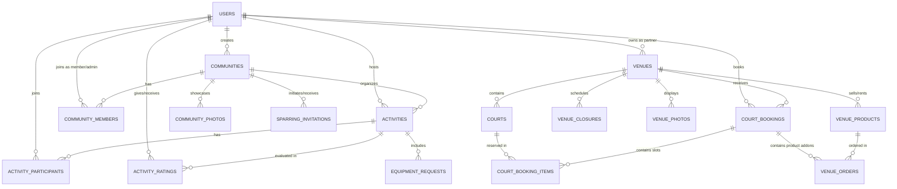

# Dokumentasi Teknis SmashMate: Ringkasan Proyek, Use Case, & Skema Basis Data

Dokumen ini disusun untuk kebutuhan penulisan paper/laporan akademik dan perancangan sistem SmashMate.

---

## 1. Deskripsi Singkat Proyek

**SmashMate** adalah platform digital berbasis web terintegrasi yang dirancang untuk memfasilitasi ekosistem olahraga bulutangkis (badminton) di Indonesia. Platform ini menjembatani interaksi antara tiga kelompok pengguna utama: **Pemain (Player)**, **Pengelola Gelanggang Olahraga / Venue Partner (GOR)**, dan **Administrator Platform (Operator)**.

### Permasalahan yang Diselesaikan:
1. Kesulitan pemain dalam mencari teman bermain bersama (*mabar*) dengan jadwal, lokasi, atau tingkat kemampuan (*skill level*) yang cocok.
2. Fragmentasi komunitas bulutangkis lokal dalam mengorganisasi jadwal sparing antar-komunitas.
3. Proses pemesanan lapangan bulutangkis (*court booking*) yang masih konvensional serta kesulitan menyewa peralatan (raket & *shuttlecock*) di venue.

### Fitur Utama:
- **Aktivitas & Matchmaking (*Mabar / Coaching / Sparring*):** Pembuatan dan pendaftaran sesi main bareng, pembatasan kuota peserta, pembagian biaya sewa, pelacakan riwayat aktivitas, dan sistem pemberian ulasan/rating antar pemain.
- **Komunitas & Sparing Antar-Komunitas:** Manajemen komunitas bulutangkis (profil, logo/banner, galeri foto, kepengurusan admin & anggota), serta alur undangan tanding sparing formal (*sparring invitation lifecycle*).
- **Marketplace Venue & Sewa Alat:** Pengecekan ketersediaan jadwal lapangan secara real-time, penyewaan multi-lapangan (*multi-item bookings*), aturan operasional venue (jadwal buka/tutup, *closure* khusus), dan pemesanan peralatan tambahan.
- **Portal Khusus Mitra Lapangan (*Partner Portal*):** Dashboard khusus pengelola venue untuk memantau pesanan masuk, mencatat kehadiran/status booking (*confirm / check-in / complete*), mengelola profil GOR, foto lapangan, dan inventaris produk.

---

## 2. Aktor Sistem & Diagram Use Case

### A. Definisi Aktor
1. **Pemain (Player):** Pengguna terautentikasi yang mencari/mengikuti mabar, mengelola/bergabung komunitas, menyewa lapangan, dan memberikan rating.
2. **Mitra GOR / Venue Partner:** Pengelola bisnis venue yang mengatur ketersediaan lapangan, katalog sewa alat, jadwal operasional, dan konfirmasi reservasi pemain.
3. **Operator / Administrator:** Pengelola platform yang memiliki akses pengawasan menyeluruh, pemantauan status sistem, dan manajemen akun mitra.
4. **Tamu (Guest / Anonim):** Pengguna yang melihat beranda publik, daftar venue, dan katalog informasi umum sebelum login/registrasi.

---

### B. Diagram Use Case (Mermaid)

```mermaid
flowchart TD
    %% Aktor
    Player(["👤 Pemain (Player)"])
    Partner(["🏢 Mitra GOR (Partner)"])
    Operator(["🛡️ Operator (Admin)"])
    Guest(["👥 Pengunjung (Guest)"])

    %% Use Case Guest & Auth
    UC_Explore["Melihat Beranda & Katalog Venue"]
    UC_Auth["Registrasi & Login Akun"]
    UC_PasswordSetup["Setup Kata Sandi Pertama (Mitra)"]

    %% Use Case Player - Aktivitas & Mabar
    UC_CreateActivity["Membuat Sesi Aktivitas (Mabar/Sparring/Coaching)"]
    UC_JoinActivity["Mendaftar / Batal Ikut Sesi Aktivitas"]
    UC_ViewHistory["Melihat Riwayat Aktivitas & Detail"]
    UC_RatePlayer["Memberikan Rating & Ulasan Pemain"]

    %% Use Case Player - Komunitas & Sparing
    UC_ManageCommunity["Membuat & Mengelola Komunitas"]
    UC_ManageMember["Mengangkat Admin & Anggota Komunitas"]
    UC_UploadCommunityMedia["Unggah Avatar, Banner, & Galeri Komunitas"]
    UC_SparringInvite["Kirim / Tanggapi Undangan Sparing Komunitas"]

    %% Use Case Player & Partner - Venue & Booking
    UC_BookCourt["Pemesanan Lapangan & Sewa Alat (Multi-Item)"]
    UC_CancelBooking["Batalkan Reservasi Lapangan"]
    UC_ManageVenue["Kelola Profil Venue, Foto, & Jadwal Buka/Tutup"]
    UC_ManageProducts["Kelola Inventaris Produk & Peralatan"]
    UC_ManageBookings["Verifikasi & Update Status Booking (Confirm/Check-in/Complete)"]

    %% Use Case Operator
    UC_ProvisionPartner["Mendaftarkan Akun Mitra Venue Baru"]
    UC_SystemOverview["Monitoring Sistem & Log Aktivitas"]

    %% Relasi Guest
    Guest --> UC_Explore
    Guest --> UC_Auth

    %% Relasi Player
    Player --> UC_Auth
    Player --> UC_Explore
    Player --> UC_CreateActivity
    Player --> UC_JoinActivity
    Player --> UC_ViewHistory
    Player --> UC_RatePlayer
    Player --> UC_ManageCommunity
    Player --> UC_ManageMember
    Player --> UC_UploadCommunityMedia
    Player --> UC_SparringInvite
    Player --> UC_BookCourt
    Player --> UC_CancelBooking

    %% Relasi Partner
    Partner --> UC_Auth
    Partner --> UC_PasswordSetup
    Partner --> UC_ManageVenue
    Partner --> UC_ManageProducts
    Partner --> UC_ManageBookings

    %% Relasi Operator
    Operator --> UC_Auth
    Operator --> UC_ProvisionPartner
    Operator --> UC_SystemOverview

    %% Include & Extend Sub-relationships
    UC_JoinActivity -.->|<<include>>| UC_ViewHistory
    UC_SparringInvite -.->|<<extend>>| UC_CreateActivity
    UC_RatePlayer -.->|<<extend>>| UC_ViewHistory
```

---

### C. Tabel Rincian Use Case Utama

| ID | Nama Use Case | Aktor Utama | Deskripsi |
| :--- | :--- | :--- | :--- |
| **UC-01** | Autentikasi & Profil | Pemain, Mitra, Operator | Pengguna mendaftar, masuk menggunakan email/password, dan mengatur profil (nama, telepon, level kemampuan). |
| **UC-02** | Manajemen Sesi Mabar | Pemain (Host) | Membuat jadwal main bersama, menentukan lokasi, tanggal, waktu, kuota slot peserta, level pemain, dan estimasi biaya. |
| **UC-03** | Bergabung / Batal Sesi | Pemain | Memilih sesi mabar yang tersedia, mendaftar ke daftar peserta, atau membatalkan kehadiran sebelum waktu sesi dimulai. |
| **UC-04** | Rating & Reputasi | Pemain | Memberikan evaluasi bintang (1–5) dan ulasan kepada sesama peserta setelah sesi berstatus selesai (*finished*). |
| **UC-05** | Manajemen Komunitas | Pemain (Ketua/Admin) | Membuat klub/komunitas, mengangkat co-admin, mengatur profil identitas, serta mengunggah galeri foto kegiatan. |
| **UC-06** | Sparing Antar-Komunitas | Pemain (Ketua/Admin) | Mengirimkan tantangan tanding antar-klub, menerima/menolak tantangan, yang secara otomatis membuat sesi jadwal sparring resmi. |
| **UC-07** | Booking Lapangan & Alat | Pemain | Memilih GOR, tanggal bermain, slot jam lapangan, serta memesan raket dan *shuttlecock* dalam satu transaksi terintegrasi. |
| **UC-08** | Manajemen Operasional Venue | Mitra GOR | Menetapkan harga lapangan, jam buka-tutup mingguan, penutupan khusus (*closure*), serta upload foto venue. |
| **UC-09** | Manajemen Reservasi Masuk | Mitra GOR | Memantau daftar reservasi harian dan mengubah status booking (*confirmed, checked_in, completed, cancelled*). |
| **UC-10** | Provisioning Mitra Baru | Operator | Mendaftarkan akun mitra pengelola venue baru ke sistem dan mengaitkannya dengan entitas GOR. |

---

## 3. Skema Basis Data (Database Schema)

Sistem menggunakan **PostgreSQL (Supabase)** dengan dukungan *Row Level Security* (RLS) serta fungsi *triggers/stored procedures* untuk konsistensi data.

### A. Diagram Entitas Relasi (ERD - Mermaid)

---

### B. Deskripsi Entitas & Tabel Utama

#### 1. Modul Pengguna & Profil (`auth.users` & metadata)
- Menyimpan identitas akun pengguna via Supabase Auth.
- Metadata mencakup `role` (`player`, `partner`, `operator`), `full_name`, `phone_number`, `skill_level` (Pemula, Menengah, Mahir), dan `must_change_password`.

#### 2. Modul Aktivitas & Sesi Main (`public.activities`)
Menyimpan sesi main bareng, coaching, maupun sparring.
- `id` (UUID, PK)
- `host_id` (UUID, FK -> `auth.users`)
- `title` (VARCHAR 120)
- `category` (VARCHAR 40): `'open_play'` (Mabar), `'sparring'`, `'drills'`
- `description` (TEXT)
- `location` (VARCHAR 160)
- `starts_at` (TIMESTAMPTZ)
- `duration_minutes` (INT, default: 120)
- `max_participants` (INT, default: 8)
- `price_per_person` (NUMERIC(12,2), default: 0)
- `skill_level` (VARCHAR 30): `'all'`, `'beginner'`, `'intermediate'`, `'advanced'`
- `community_id` (UUID, FK -> `communities`, nullable)
- `created_at` (TIMESTAMPTZ)

#### 3. Peserta Aktivitas (`public.activity_participants`)
Mencatat partisipasi pemain dalam suatu sesi.
- `id` (UUID, PK)
- `activity_id` (UUID, FK -> `activities`)
- `user_id` (UUID, FK -> `auth.users`)
- `joined_at` (TIMESTAMPTZ)
- *Constraint:* UNIQUE(`activity_id`, `user_id`)

#### 4. Penilaian & Reputasi Pemain (`public.activity_ratings`)
Sistem rating antar pemain setelah sesi berakhir.
- `id` (UUID, PK)
- `activity_id` (UUID, FK -> `activities`)
- `rater_id` (UUID, FK -> `auth.users`)
- `rated_user_id` (UUID, FK -> `auth.users`)
- `rating` (INT, CHECK 1 - 5)
- `comment` (TEXT, max 300 char)
- `created_at` (TIMESTAMPTZ)
- *Constraint:* UNIQUE(`activity_id`, `rater_id`, `rated_user_id`)

#### 5. Komunitas (`public.communities`)
Pusat perkumpulan klub bulutangkis lokal.
- `id` (UUID, PK)
- `name` (VARCHAR 100, UNIQUE)
- `slug` (VARCHAR 120, UNIQUE)
- `description` (TEXT)
- `city` (VARCHAR 80)
- `home_court` (VARCHAR 120)
- `level` (VARCHAR 40)
- `logo_url` (TEXT)
- `banner_url` (TEXT)
- `created_by` (UUID, FK -> `auth.users`)
- `created_at` (TIMESTAMPTZ)

#### 6. Anggota & Admin Komunitas (`public.community_members`)
- `id` (UUID, PK)
- `community_id` (UUID, FK -> `communities`)
- `user_id` (UUID, FK -> `auth.users`)
- `role` (VARCHAR 20): `'owner'`, `'admin'`, `'member'`
- `joined_at` (TIMESTAMPTZ)
- *Constraint:* UNIQUE(`community_id`, `user_id`)

#### 7. Undangan Sparing Antar-Komunitas (`public.sparring_invitations`)
Alur tantangan bertanding antara 2 komunitas.
- `id` (UUID, PK)
- `challenger_community_id` (UUID, FK -> `communities`)
- `opponent_community_id` (UUID, FK -> `communities`)
- `host_id` (UUID, FK -> `auth.users`)
- `title` (VARCHAR 120)
- `description` (TEXT)
- `location` (VARCHAR 160)
- `starts_at` (TIMESTAMPTZ)
- `duration_minutes` (INT)
- `status` (VARCHAR 30): `'pending'`, `'accepted'`, `'declined'`, `'cancelled'`
- `activity_id` (UUID, FK -> `activities`, nullable, dibuat otomatis saat diterima)
- `created_at` (TIMESTAMPTZ)

#### 8. Venue / Gelanggang Olahraga (`public.venues`)
Profil fasilitas GOR yang dikelola mitra.
- `id` (UUID, PK)
- `partner_id` (UUID, FK -> `auth.users`)
- `name` (VARCHAR 120)
- `slug` (VARCHAR 140, UNIQUE)
- `address` (TEXT)
- `city` (VARCHAR 60)
- `contact_phone` (VARCHAR 40)
- `open_time` (TIME, default: 07:00)
- `close_time` (TIME, default: 23:00)
- `rules` (TEXT)
- `facilities` (TEXT[])
- `is_active` (BOOLEAN, default: true)
- `created_at` (TIMESTAMPTZ)

#### 9. Lapangan (`public.courts`)
Data unit lapangan di setiap venue.
- `id` (UUID, PK)
- `venue_id` (UUID, FK -> `venues`)
- `name` (VARCHAR 60, e.g. "Lapangan 1 (Karpet Yonex)")
- `price_per_hour` (NUMERIC(12,2))
- `floor_type` (VARCHAR 40): `'vinyl'`, `'parquet'`, `'rubber'`, `'cement'`
- `is_active` (BOOLEAN, default: true)

#### 10. Pemesanan Lapangan (`public.court_bookings`)
Header transaksi booking venue oleh pemain.
- `id` (UUID, PK)
- `venue_id` (UUID, FK -> `venues`)
- `user_id` (UUID, FK -> `auth.users`)
- `total_price` (NUMERIC(12,2))
- `status` (VARCHAR 30): `'pending'`, `'confirmed'`, `'checked_in'`, `'completed'`, `'cancelled'`
- `notes` (TEXT)
- `created_at` (TIMESTAMPTZ)

#### 11. Item Slot Booking (`public.court_booking_items`)
Detail slot jam dan unit lapangan yang disewa (mendukung multi-lapangan & multi-jam).
- `id` (UUID, PK)
- `booking_id` (UUID, FK -> `court_bookings`)
- `court_id` (UUID, FK -> `courts`)
- `booking_date` (DATE)
- `start_hour` (INT, CHECK 0 - 23)
- `end_hour` (INT, CHECK 1 - 24)
- `price` (NUMERIC(12,2))
- *Constraint:* UNIQUE(`court_id`, `booking_date`, `start_hour`) untuk mencegah *double-booking*.

#### 12. Produk & Layanan Venue (`public.venue_products`)
Katalog raket, shuttlecock, minuman, atau layanan stringing.
- `id` (UUID, PK)
- `venue_id` (UUID, FK -> `venues`)
- `category` (VARCHAR 40): `'racket'`, `'shuttlecock'`, `'beverage'`, `'service'`
- `name` (VARCHAR 120)
- `brand` (VARCHAR 60)
- `price` (NUMERIC(12,2))
- `is_rental` (BOOLEAN, default: false)
- `stock` (INT, default: 0)

#### 13. Pesanan Produk Tambahan (`public.venue_orders`)
Detail barang sewa/beli yang disertakan saat booking lapangan.
- `id` (UUID, PK)
- `booking_id` (UUID, FK -> `court_bookings`)
- `product_id` (UUID, FK -> `venue_products`)
- `quantity` (INT)
- `unit_price` (NUMERIC(12,2))
- `subtotal` (NUMERIC(12,2))

---

## 4. Ringkasan Keamanan & RLS (Row Level Security)

Sistem menerapkan prinsip *Least Privilege* dengan PostgreSQL RLS:
1. **Pemain:**
   - Dapat membaca semua aktivitas publik, venue, dan profil komunitas terbuka.
   - Hanya dapat mengubah data aktivitas jika bertindak sebagai `host`.
   - Hanya dapat menilai peserta lain dalam aktivitas yang pernah diikuti dan telah berstatus selesai.
2. **Mitra Venue:**
   - Memiliki kendali penuh (*CRUD*) hanya atas data venue, lapangan, produk, foto, dan jadwal tutup yang terhubung dengan `partner_id` miliknya.
   - Hanya dapat mengubah status booking lapangan pada venue milik sendiri.
3. **Pengurus Komunitas (Owner & Admin):**
   - Berhak memperbarui profil komunitas, mengubah peran anggota, mengunggah galeri foto, serta menerima/menolak undangan sparing.

